I work where markets, probability and code meet: volatility modelling, derivatives pricing, and machine learning on noisy financial time series.

<a href="https://claude.ai/artifact/Hza4orUi9ChT762MpRuPvj"><b>▶ Full animated portfolio</b></a>

### [VMarket](https://github.com/Krithikk18/VMarket): Volatility Forecasting on NSE Large-Caps
Forecasting daily volatility for **HDFCBANK, RELIANCE and INFY (2015–2024)**.
- Benchmarks **GARCH, GARCH-t and GJR-GARCH** against **LSTM** and ensemble models
- Evaluated with **MSE, MAE and QLIKE**, with **Diebold-Mariano tests** for statistical significance
- Walk-forward, out-of-sample evaluation (no look-ahead bias)
- 🔄 *Currently rebuilding every notebook from scratch for full reproducibility*

<!-- Once you have results, replace the line above with something like:
**Key result:** GJR-GARCH beat LSTM on QLIKE for 2 of 3 stocks (DM test, p < 0.05) -->

### Black-Scholes, from first principles
Working through the derivation: no-arbitrage, replication, risk-neutral pricing.
- Next: Greeks and an implied volatility solver
- Then: Monte Carlo vs binomial-tree comparison
- 🔄 *In progress*

### Explainable IoT Intrusion Detection
Hardware-aware anomaly detection for home and IoT networks.
- **Hardware-aware NAS** producing compressed models per device tier
- **SHAP** explainability and **adversarial robustness** testing
- Datasets: N-BaIoT, IoT-23, UNSW-NB15

### Operations Dashboard
Full-stack dashboard for a real oil-products business, built with React, Vite and Supabase.

**Languages:** Python · C++ · SQL · JavaScript  
**Quant & Data:** NumPy · Pandas · SciPy · statsmodels · arch · scikit-learn  
**ML:** PyTorch · SHAP  
**Tools:** Jupyter · Git · React · Supabase

**Currently learning**
- Probability & combinatorics (Harvard Stats 110, brain teasers)
- Time-series econometrics & volatility modelling
- Stochastic calculus basics for options pricing
- Data structures & algorithms in C++
- Mental math speed (Zetamac)

**Interests:** Indian macroeconomics · public finance · how markets price risk

> *"The difference between playing the stock market and the horses is that one of the horses must win."* (Joey Adams)
