I'm a computer science undergrad specialising in cyber security at Amrita Vishwa Vidyapeetham, Coimbatore. I build software where machine learning meets real systems: catching intrusions on home and IoT networks, and making sense of financial markets.

### [Explainable intrusion detection — paper replication](https://github.com/Krithikk18/XAI_Result_replication)
Full replication of *Explainable AI and Random Forest Based Reliable Intrusion Detection System* on CSE-CIC-IDS2018.
- Seven-stage pipeline: preprocessing → Random Forest → secondary classifiers → SHAP (TreeExplainer) → CAM → clean evaluation → HopSkipJump adversarial testing
- 99.96% Random Forest accuracy, with a written account of where results diverged from the paper and why
- Built to fit a 4 GB laptop GPU: stratified sampling, and a scikit-learn fallback when cuML ran out of memory

### IoT intrusion detection research
Lightweight, explainable anomaly detection for smart-home networks.
- Separate models sized for each device class, from microcontroller sensors to the home gateway
- Explainability and adversarial robustness treated as requirements, not extras
- Datasets: N-BaIoT · IoT-23 · UNSW-NB15

### [HW-NAS Demo](https://github.com/Krithikk18/HW-NAS_Demo): hardware-aware neural architecture search
A DARTS-style supernet that searches for an intrusion-detection model small enough for the device it runs on.
- Bilevel optimisation: weights learn on training data, architecture learns on validation data plus a hardware penalty (parameters and FLOPs)
- Three device tiers, from microcontroller to gateway, each with its own budget
- Derives a plain PyTorch model from the searched cells, ready to deploy

### [ML Notebooks](https://github.com/Krithikk18/ML_Notebooks)
Machine learning fundamentals, worked through from scratch.

### [VMarket](https://github.com/Krithikk18/VMarket): volatility forecasting
- GARCH-family models benchmarked against LSTM, with FinBERT news sentiment as an extra signal
- Walk-forward, out-of-sample evaluation with no look-ahead; scored on MSE, MAE and QLIKE with Diebold-Mariano tests
- 🔄 Now extending to Indian large-caps (HDFCBANK, RELIANCE, INFY), rebuilt for full reproducibility

### [Mandate Retry Sequencer](https://github.com/Krithikk18/mandate-retry-sequencer) · Razorpay AI Buildathon
A cost-aware retry policy for failed recurring payments on Indian e-mandates.
- Prices every possible retry date in rupees: expected recovery minus fees, bounce charges and the risk of losing the customer
- Works within NPCI rules: 24-hour pre-debit notice, four attempts per cycle, 00:00–07:00 IST window
- In simulation, lifts recovery from ~32% (fixed schedule) to ~57%; 298 tests passing

### [MarketPulse](https://github.com/Krithikk18/MarketPulse)
A Streamlit app for equity research: LSTM price forecasts alongside FinBERT sentiment.

**Languages:** Python · C++ · SQL · TypeScript / JavaScript  
**ML & data:** PyTorch · scikit-learn · SHAP · NumPy · Pandas · statsmodels · arch  
**Web & tools:** React · Supabase · Streamlit · Git · Jupyter · WSL2

**Currently learning:** probability (Harvard Stats 110) · time-series econometrics · data structures & algorithms in C++ · options pricing basics  
**Interests:** Indian macroeconomics · public finance · how markets price risk

> *The difference between playing the stock market and the horses is that one of the horses must win." * — Joey Adams
